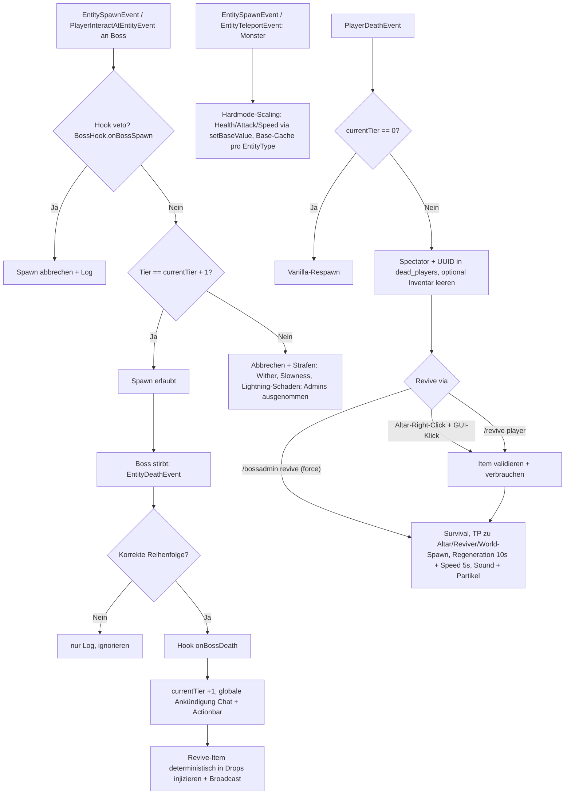

# Plan: Paper Boss-Progression & Permadeath Plugin

> Stand: Phase 1 vollständig implementiert & getestet (alle T1–T16 erledigt, `mvn clean verify` grün, `target/BossProgression-1.0.0.jar` gebaut). Dieser Plan dokumentiert die **tatsächlich in der Entwicklung getroffenen architektonischen Entscheidungen** (abweichend vom ursprünglichen Entwurf dort, wo die Entwicklung andere Wege ging).

## Entscheidungen (bestätigt vom User & umgesetzt)
- **Build-Tool:** Maven (kein Wrapper, lokal in `%USERPROFILE%\.tools\apache-maven-3.9.16\bin`)
- **Scope Phase 1:** Vanilla-only (MythicMobs erst Phase 2, SPI `BossHook` + `MythicMobsHook`-Platzhalter bereits vorhanden)
- **Revive:** Beide Optionen (Altar-System + `/revive <player>` + Admin-Forcemechanik)
- **Boss-Tiers:** Frei konfigurierbar in `config.yml` (Warden, Wither, Ender Dragon) — Boss-Identität komplett config-driven, kein Hardcoding
- **Plattform:** Paper API 26.3 (`paper-api:26.3.build.200-stable`, `api-version: '1.21'`), Java 25, Tests mit MockBukkit 4.x (`mockbukkit-v26.3` 4.118.0) + JUnit Jupiter 6.1.3

## Architektur

```
com.example.bossprogression
├── BossProgressionPlugin.java        # Hauptklasse, Wiring in onEnable/onDisable, Accessor-Methoden
├── config/
│   ├── ConfigManager.java            # config.yml laden/validieren/reloaden (Fehler -> Plugin disable)
│   ├── BossTier.java                 # record (tierNumber, EntityType, displayName, reviveItem)
│   ├── ReviveItemConfig.java         # Material, CMD, DisplayName, PDC-Key/-Value, createItem()
│   ├── AltarConfig.java              # record: enabled, Block, Partikel, Sound
│   ├── PenaltyConfig.java            # record: radius, Wither/Slowness-Amps, Dauer, Lightning-%
│   └── HardmodeConfig.java           # record: enabled, Multiplizierfaktoren, Nerf-Flags
├── data/
│   └── DataStore.java                # data.yml: tier, dead_players, altar_location; debounced + periodischer Autosave
├── progression/
│   ├── ProgressionManager.java       # einziger Tier-Mutator; advance(), setTier(), isAllowed()
│   ├── SpawnGuardListener.java       # EntitySpawnEvent + PlayerInteractAtEntityEvent + Hook-Veto
│   └── BossDeathListener.java        # EntityDeathEvent -> Hook-Callback + advance + Loot-Injection
├── permadeath/
│   └── PermadeathListener.java       # PlayerDeathEvent (Spectator) + PlayerJoinEvent (Recovery)
├── revive/
│   ├── ReviveManager.java            # ReviveResult-Enum, force-Flag, Buffs, TP, Sound/Partikel
│   └── ReviveItemValidator.java      # PDC → CMD → DisplayName-Matching, consumeOne()
├── altar/
│   ├── AltarManager.java             # GUI (27 Slots, PLAYER_HEAD), Auto-Close, isAltarBlock()
│   └── AltarListener.java            # Right-Click am Altar-Block + InventoryClickEvent (GUI-Titel)
├── hardmode/
│   ├── HardmodeManager.java          # Attribute-Scaling via setBaseValue + EnumMap-Base-Cache
│   └── HardmodeListener.java         # Spawn/Teleport-Scaling + Regen-/Apple-Nerfs
├── command/
│   ├── BossStatusCommand.java        # /boss status
│   ├── AltarCommand.java             # /altar
│   ├── ReviveCommand.java            # /revive <player>
│   └── BossAdminCommand.java         # /bossadmin (settier, revive, setaltar, reload)
├── hook/
│   ├── BossHook.java                 # SPI: id/onEnable/onDisable/isBossType/onBossSpawn(veto)/onBossDeath
│   ├── BossHookManager.java          # discoverAndEnable(), Throwable-Isolation aller Hook-Calls
│   └── MythicMobsHook.java           # [Phase 2] Platzhalter (alle Defaults, inaktiv)
└── util/
    └── Messages.java                 # messages.yml, raw/plain, {placeholders}, prefix
```

### Event-Fluss



### Schlüssel-Entscheidungen
1. **Spawn-Guard (Vanilla):** Boss-Entity-Typen kommen ausschließlich aus `config.yml` (`boss-tiers.*.entity-type`). Abfangen über `EntitySpawnEvent` (**ohne** SpawnReason-Filter — jeder Spawn eines konfigurierten Boss-Typs wird geprüft) und `PlayerInteractAtEntityEvent` (Rechtsklick auf den Boss), beide `EventPriority.HIGH, ignoreCancelled = true`. Vor dem Tier-Check wird `BossHookManager.anyVetoSpawn()` abgefragt (Hook-Veto bricht den Spawn ab). Strafen (`PenaltyConfig`): Spieler im Radius bekommen Wither + Slowness (visible, keine Ambient-Particles), `maxHealth * lightning-damage-percent` Schaden und Lightning-Effect; **Spieler mit `bossplugin.admin` werden ausgenommen**.
2. **Loot-Injection:** Beim Boss-Tod via `EntityDeathEvent` werden die Drops deterministisch ergänzt (`ReviveItemConfig.createItem()`). Wichtig: In Paper 26.x ist `EntityDeathEvent#getDrops()` **read-only** — Drops werden daher aus der `EntityEquipment` des Toten berechnet/abgeleitet, das Revive-Item wird zusätzlich injiziert. Außerhalb der richtigen Reihenfolge gestorbene Bosse werden **ignoriert** (Log nur, keine Progression, kein Item, keine Strafe — Strafe erfolgt nur bei Spawn/Interaktion).
3. **Item-Identität & -Validierung:** PDC-Tags sind **config-driven** (`revive-item.pdc-key: revive`, `pdc-value: tierN` — bare Keys ohne `:`, Namespace `bossprogression` kommt vom `NamespacedKey`-Konstruktor), nicht hartkodiert. Matching-Priorität: `pdc-key`/`pdc-value` → `custom-model-data` (>0) → DisplayName (ChatColor-translated). Das Revive-Item ist nur für das **letzte freigeschaltete** Tier gültig (`ReviveItemValidator.latestUnlockedTier()` = `configManager.getTier(currentTier)`).
4. **Data-Safety:** `DataStore` ist **Single Source of Truth** für Tier/Dead-Players/Altar; `ProgressionManager` ist der einzige erlaubte Tier-Mutator (per Javadoc fixiert). Persistenz in `data.yml`: `markDirty()` (debounced Save auf nächstem Tick via `Bukkit.getScheduler().runTask`) + periodischer Autosave (`data.auto-save-minutes: 5` via `runTaskTimer`) + `synchronized save()` bei `onDisable`. Dead-Player-Status übersteht Server-Neustart (Spectator beim Login wiederherstellen via `PlayerJoinEvent`, MONITOR).
5. **Hardmode:** Lazy-Scaling bei `EntitySpawnEvent` **und** `EntityTeleportEvent` (beide MONITOR — aus Chunks geladene Monster "spawnen" nicht). `HardmodeManager` skaliert `MAX_HEALTH`/`ATTACK_DAMAGE`/`MOVEMENT_SPEED` per `setBaseValue(base * multiplier)`, Multiplikator = `base-multiplier + per-tier-multiplier * currentTier` (nur > 1.0 wirksam), nur für `Monster`, Boss-Typen ausgenommen. **Base-Wert-Cache** (`EnumMap<EntityType, Double>`) verhindert Verrechnung bei wiederholtem Scaling (Re-Cache wenn `current <= cached`); `reset()` nach `settier`/`reload`. Nerfs: `FoodLevelChangeEvent` (HIGH) cappt Regeneration bei 19 Food; `PlayerItemConsumeEvent` (HIGH) cancelt Golden Apple — jeweils als `true/false`-Flags.
6. **Hook-SPI (Phase 2 vorbereitet):** `BossHook`-Interface mit Defaults: `id()`, `onEnable(plugin)`, `onDisable()`, `isBossType(EntityType)→false`, `onBossSpawn(entity, tier)→false` (true = Veto), `onBossDeath(entity, tier)`. `BossHookManager` ruft alle Hooks mit **`catch (Throwable)`-Isolation** auf — ein defekter Hook darf Core-Gameplay nie crashen. `softdepend: [MythicMobs]` in `plugin.yml`; ohne aktiven Hooks loggt das Plugin "Vanilla-only mode".
7. **Revive-Mechanik:** `ReviveManager.revive(target, actor, location, force)` liefert `ReviveResult`-Enum (`SUCCESS`, `NOT_DEAD`, `CANNOT_REVIVE_SELF`, `NO_ITEM`). Effekte: **Regeneration 10s (Amp 1) + Speed 5s (Amp 0)** — bewusst **keine** Invulnerability. Dazu voller Health, Food 20, Feuer gelöscht, TP (Cause PLUGIN). Ziel-Lokalisierung: Altar (falls gesetzt) → Position des Revivers → World-Spawn des Opfers. `force=true` (nur `/bossadmin revive`) umgeht Dead-Check und Item-Verbrauch. Feedback: Sound `ENTITY_ENDER_DRAGON_GROWL` + 60× `HAPPY_VILLAGER`-Partikel, Meldung an Ziel + Broadcast.
8. **Messages:** Alle Spieler-facing Strings in `messages.yml` (prefix `&8[&6BossProgress&8] `, `{placeholder}`-Substitution, `&`-Farbcodes). `Messages.raw(...)` mit Prefix (Chat), `Messages.plain(...)` ohne (GUI-Titel/Item-Namen); Actionbars via `LegacyComponentSerializer.legacySection()`. Fehlende Keys → roter Fallback statt Exception.
9. **Konventions (im Code verankert):** `final`-Klassen, Constructor-Injection von `BossProgressionPlugin`, keine Lombok/SLF4J (`plugin.getLogger()`); Accessor-Methode-Stil auf der Plugin-Klasse (`plugin.dataStore()`, keine Getter-Setter); Event-Listener durchweg `@EventHandler(priority = HIGH, ignoreCancelled = true)` (MONITOR wo Reihenfolge egal ist); Konfigurations-Fehler bei `ConfigManager.load()` → Plugin deaktiviert sich selbst.

## Todo-Liste (ausführbar)

- [x] **T1:** Maven-Projekt anlegen: `pom.xml` (paper-api 26.3, Java 25, MockBukkit 4.x, JUnit 6.1.3, Resource-Filtering für `${project.version}`), Package-Struktur, `plugin.yml` (4 Befehle, Permissions, `api-version: '1.21'`, `softdepend: [MythicMobs]`)
- [x] **T2:** `ConfigManager` + `BossTier`/`AltarConfig`/`PenaltyConfig`/`HardmodeConfig`/`ReviveItemConfig`-Records + Default-`config.yml` (Boss-Tiers mit EntityType/Name/Revive-Item inkl. PDC, Altar-Settings, Strafen, Hardmode-Faktoren, Permadeath-Flag, Autosave) inkl. Validierung (Tier >0, gültige EntityType/Material, sortiert, keine Duplikate; Fehler → Plugin-Disable)
- [x] **T3:** `DataStore` für `data.yml` (`current_boss_tier`, `dead_players` als UUID-Strings, `altar_location` mit yaw/pitch) mit debounced `markDirty()` + periodischem Autosave + Login-Recovery
- [x] **T4:** `ProgressionManager` (get/advance/setTier mit Bounds-Check, `isAllowed(n) = n == currentTier + 1`, globale Ankündigung via Chat + Actionbar)
- [x] **T5:** `SpawnGuardListener`: `EntitySpawnEvent` + `PlayerInteractAtEntityEvent` abfangen, Hook-Veto-Check, Tier-Check, Abbrechen + Strafen (Wither, Slowness, Lightning-Schaden) an Spieler im Radius, Admin-Exemption
- [x] **T6:** `BossDeathListener`: `EntityDeathEvent` — außer-Reihenfolge ignorieren, Hook-Callback vor `advance()`, Revive-Item in Drops injizieren, Broadcast; `HardmodeManager.reset()` bei `settier`/`reload`
- [x] **T7:** `PermadeathListener`: `PlayerDeathEvent` — Tier 0: Vanilla; Tier > 0: Spectator + `markDead` + Meldung; `permadeath.clear-inventory-on-death` konfigurierbar (Drops + Inventar leeren); `PlayerJoinEvent` erzwingt Spectator für dead-marked Spieler
- [x] **T8:** `ReviveManager` + `ReviveItemValidator`: Item-Validierung (PDC → CMD → DisplayName) nur für letztes freigeschaltetes Tier, `ReviveResult`-Enum, Respawn mit Regeneration + Speed, TP zu Altar/Reviver/World-Spawn, `force`-Pfad für Admins
- [x] **T9:** `AltarManager` + `AltarListener` + `/altar` + `/bossadmin setaltar`: Right-Click am Altar-Block (Block-Änderung wird gemeldet), 27-Slot-Chest-GUI mit `PLAYER_HEAD` pro totem Spieler (slot→UUID-Map, Klicks immer gecancelt, Auto-Close bei >16 Blöcken Distanz)
- [x] **T10:** `/revive <player>`-Befehl (nutzt `ReviveManager`, Permission `bossplugin.revive`, Tab-Completion für tote Spieler)
- [x] **T11:** `HardmodeManager` + `HardmodeListener`: Monster-Attribute (Health/Attack/Speed) via `setBaseValue` + EnumMap-Base-Cache skalieren, Trigger auf Spawn **und** Teleport, Regen-Cap (Food 19) und Golden-Apple-Nerf als Flags
- [x] **T12:** `/boss status`-Befehl (aktuelles Tier, nächster Boss, benötigtes Revive-Item, "all completed"-Zustand, Permission `bossplugin.status`)
- [x] **T13:** `/bossadmin`-Befehl: `settier <0..N>`, `revive <player>` (force, ohne Item), `setaltar` (am Spielerstandort), `reload` (Config + Messages + markDirty) — Permission `bossplugin.admin`, Tab-Completion
- [x] **T14:** `hook/`-SPI: `BossHook`-Interface (Defaults, `onBossSpawn`-Veto) + `BossHookManager` (Discovery via `isPluginEnabled`, Throwable-Isolation) + `MythicMobsHook`-Platzhalter (inaktiv bis Phase 2)
- [x] **T15:** MockBukkit-Tests (alle erben von `PluginTestBase` mit `MockBukkit.load`/`unmock`): DataStoreTest, PermadeathListenerTest, BossDeathListenerTest, ProgressionManagerTest, SpawnGuardListenerTest (chunk-basierte Spawns `@Disabled` — MockBukkit mockt `getChunkAt` nicht), ReviveItemValidatorTest
- [x] **T16:** `messages.yml` für alle Spieler-Meldungen, Logging via `plugin.getLogger()` (Plain-Strings), Null-Safety-Pass, `mvn clean verify -B -ntp` baut sauber (`target/BossProgression-1.0.0.jar`)

### Phase 2 (später, eigener Task)
- MythicMobs: `MythicMobsHook` aktivieren — MM-Boss-Mobs parsen und als `BossTier` registrieren, `isBossType` override, `MythicMobSpawnEvent`/`MythicMobDeathEvent` abfangen, Spawn-Veto außerhalb der Reihenfolge; Steps stehen im Javadoc der Klasse.

## Reihenfolge & Abhängigkeiten
T1 → T2 → T3 → T4 → (T5, T6 parallel) → T7 → T8 → (T9, T10 parallel) → T11 → (T12, T13 parallel) → T14 → T15 → T16 — **vollständig durchlaufen (Phase 1 abgeschlossen)**.
