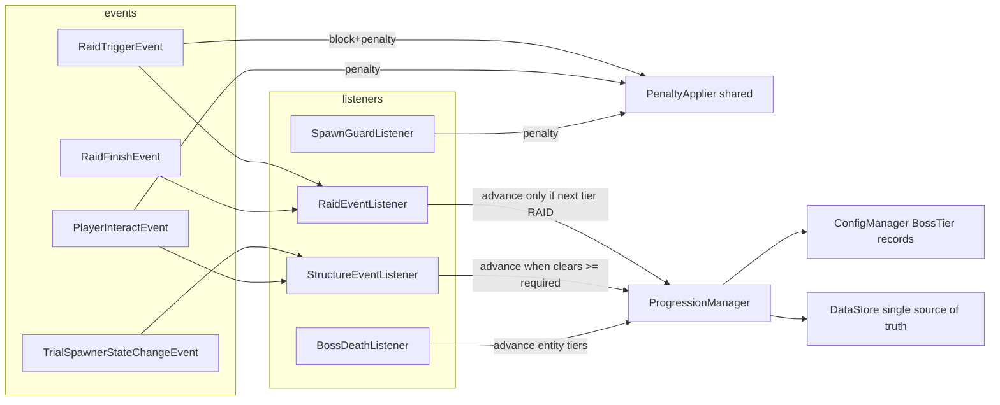

# Phase 2: Progression-Erweiterung (Raid + Trial Chambers)

Plan für die Umsetzung von `update.md` im BossProgression-Plugin (Paper 26.3 / Java 25 / Maven / MockBukkit 4.x).

## Abgesprochene Scope-Entscheidungen

| Frage | Entscheidung |
|---|---|
| MythicMobsHook-Aktivierung | **Nicht** in Phase 2 — `MYTHIC_MOB`-Wert in `TierType` wird nur vorsorglich im Modell/Parser mitgeführt, Hook bleibt Placeholder (separates Follow-up) |
| Temple-Support | `STRUCTURE_CLEAR` deckt in Phase 2 **nur Trial Chambers** ab (`TrialSpawnerStateChangeEvent`); `structure-kind: TEMPLE` wird im Config-Modell vorgesehen, aber ohne Event-Logik (dokumentiert) |
| Spawner-Clear-Counter | **In-memory** (`Map<Integer, Integer>` pro Tier) — resettet nach Server-Neustart (dokumentiertes Verhalten) |
| Raid-Revive-Item | An **jeden Gewinner** ins Inventar (`RaidFinishEvent#getWinners()`), bei vollem Inventar als Ground-Drop am `Raid#getLocation()` |
| `required-raid-waves` | **Mindestwellen-Schwelle**: Sieg zählt nur, wenn `Raid#getTotalWaves() >= required-raid-waves` |

## Verifizierte API-Fakten (Paper 26.3 Javadoc)

- `RaidTriggerEvent` (`org.bukkit.event.raid`): **cancellable**, Ctor `(Raid, World, Player)`, `getPlayer()`.
- `RaidFinishEvent` (`org.bukkit.event.raid`): **nicht** cancellable, Ctor `(Raid, World, List<Player>)`, `getWinners(): List<Player>` (nur online).
- `Raid` (Interface): `getLocation()`, `getTotalWaves()`, `getSpawnedGroups()`, `getStatus()`, `isStarted()`, `getHeroes()`, `getBadOmenLevel()` — **keine `stop()`-Methode** (update.md-Korrektur: Trigger-Block = Event canceln).
- `TrialSpawner` (`org.bukkit.block`, erbt `TileState`, `PersistentDataHolder`): `isOminous()`, `getNormalConfiguration()`, `getOminousConfiguration()`, Cooldown-Accessoren.
- `TrialSpawnerStateChangeEvent` (Paper, Package `org.bukkit.event.entity`): State-Übergang eines Trial Spawners; State-Enum `TrialSpawnerState` mit `LOCKED/ACTIVE/COMPLETED` (exakte Signatur `getTrialSpawner()/getState()/getPreviousState()` bei Implementierung gegen 26.3-Javadoc final abgleichen).
- Block-Materialien für Interact-Gate: `Material.TRIAL_SPawner`, `Material.OMEN_VAULT`.
- `Vault` BlockData mit `Vault.State` — Phase 2 nicht direkt benötigt (Gate über Blockmaterialien).

## Architektur (Datenfluss bleibt unidirektional)



Invarianten bleiben erhalten: `DataStore` bleibt Single Source of Truth für `current_boss_tier`; `ProgressionManager#advance()` bleibt einziger Tier-Mutator; alle Strings in `messages.yml` via `Messages`; Admin-Exemption `bossplugin.admin` zentral.

## Modell- & Config-Änderungen

### 1. `TierType` (neue Datei `config/TierType.java`)

```java
public enum TierType { VANILLA, MYTHIC_MOB, RAID, STRUCTURE_CLEAR }
```

### 2. `BossTier`-Record erweitert (rückwärtskompatibel)

```java
public record BossTier(
        int tierNumber,
        TierType type,
        @Nullable EntityType entityType,   // nur VANILLA / MYTHIC_MOB
        String id,                         // z. B. "town-raid", "trial-chamber"
        String displayName,
        int requiredRaidWaves,             // nur RAID, 0 = keine Schwelle
        StructureKind structureKind,       // nur STRUCTURE_CLEAR: TRIAL_CHAMBER | TEMPLE
        int requiredSpawnerClears,         // nur STRUCTURE_CLEAR
        ReviveItemConfig reviveItem)
```

- `StructureKind` (neue Enum, `config/StructureKind.java`): `TRIAL_CHAMBER`, `TEMPLE` (TEMPLE ohne Event-Logik, dokumentiert).
- `isEntityTypeTier()` Helper: `type == VANILLA || type == MYTHIC_MOB`.

### 3. `ConfigManager#loadBossTiers` typ-conditional

- Fehlendes `type` → Default `VANILLA` (Phase-1-Configs laden unverändert).
- `VANILLA`/`MYTHIC_MOB`: `entity-type` **required** (wie heute); fehlend → Load-Fehler.
- `RAID`: `required-raid-waves` (int, Default 0); `entity-type` verboten.
- `STRUCTURE_CLEAR`: `required-spawner-clears` (int ≥ 1), `structure-kind` (Default `TRIAL_CHAMBER`); `entity-type` verboten.
- Fehlendes `id` → Default aus `entity-type` bzw. `type` abgeleitet.
- Sortierung nach `tierNumber` + Duplikat-Check bleibt erhalten.

### 4. `config.yml`

Die 3 bestehenden VANILLA-Tiers bleiben unverändert. Zusätzlich **auskommentierte** Beispieltiers (RAID, STRUCTURE_CLEAR) mit Erklärung — neue Installationen behalten exakt das Phase-1-Verhalten.

## Shared PenaltyApplier

- Neue Klasse `progression/PenaltyApplier` (Constructor-Injection `BossProgressionPlugin`):
  - `void applyAround(Location center, BossTier offendingTier)` — heutige `SpawnGuardListener#applyPenalty`-Logik (WITHER/Slowness/Blitzschaden/Actionbar, Admin-Exemption, `penalty.enabled`-Gate).
  - `void applyTo(Player player, BossTier offendingTier)` — Einzel-Spieler-Variante für Raid-Trigger (gleiche Effekte + Message).
- `SpawnGuardListener` delegiert (privater `applyPenalty` entfernt) — Verhalten byte-for-byte identisch.

## ProgressionManager-Refactor

`advance()`:
- Message-Key je `TierType`: `boss-killed.global` (VANILLA/MYTHIC_MOB), `raid-cleared.global` (RAID), `structure-cleared.global` (STRUCTURE_CLEAR) — Platzhalter `{boss}`/`{tier}` wie heute.
- Log-Zeile null-sicher: `entityType()` nur bei Entity-Tiers loggen (NPE-Risiko aus Phase 1 bei null-Entity-Tiers beseitigt).
- `getNextAllowedBoss()`/`isAllowed()`/`isProgressionComplete()` unverändert (arbeiten über `tierNumber`).

## RaidEventListener (neu, `progression/RaidEventListener.java`)

### `RaidTriggerEvent` (HIGH, ignoreCancelled, cancellable)
1. Nächster Tier = `progressionManager().getNextAllowedBoss()`.
2. Ist der nächste Tier **kein** `RAID`-Tier (oder Progression abgeschlossen) → Block:
   - `event.setCancelled(true)` (ersetzt die in update.md genannte, nicht existierende `raid.stop()`).
   - `BAD_OMEN` + `RAID_OMEN` PotionEffects von `event.getPlayer()` entfernen.
   - `penaltyApplier.applyTo(player, nextTier)` — Admins (`bossplugin.admin`) von der Strafe befreit, aber Block + Message erhalten sie trotzdem.
   - Message `raid.trigger-blocked` + Actionbar an den auslösenden Spieler.
3. Ist der nächste Tier `RAID` → Raid läuft normal weiter (kein Eingriff).

### `RaidFinishEvent` (HIGH)
1. Nächster Tier muss `RAID` sein, sonst ignorieren (Raid passierte bereits, keine Strafe).
2. Wellen-Schwelle: `event.getRaid().getTotalWaves() >= tier.requiredRaidWaves()` (bei 0 immer erfüllt), sonst ignorieren + Info-Log.
3. `progressionManager().advance()` (sendet `raid-cleared.global`).
4. Revive-Item: für jeden `event.getWinners()` → `reviveItem().createItem(plugin, 1)`; `player.getInventory().addItem(...)`; Overflow-Return → `world.dropItemNaturally(raid.getLocation(), item)`.
5. Nachricht `raid-cleared.winner-item` an jeden Gewinner.

## StructureEventListener (neu, `progression/StructureEventListener.java`)

In-memory-State (kein DataStore):
- `ConcurrentHashMap<Integer, Integer> clearedCounts` (Tier-Nummer → Clear-Count).
- `ConcurrentHashMap<Integer, Set<Location>> countedSpawners` (dedup: ein Spawner zählt pro Tier nur einmal — nach Cooldown kann ein Spawner wieder ACTIVE→COMPLETED gehen).
- Reset der Maps, sobald sich `currentTier` ändert (bei `advance()` bzw. `setTier()` — einfach: bei jedem Event prüfen, ob gezählte Tiers nicht mehr der nächste erlaubte Tier sind → Map leeren).

### `TrialSpawnerStateChangeEvent` (HIGH)
1. Nur Übergang `→ COMPLETED` (aus `LOCKED` oder `ACTIVE`) wertet.
2. Nächster Tier muss `STRUCTURE_CLEAR` mit `structureKind == TRIAL_CHAMBER` sein, sonst ignorieren.
3. Spawner-`Location` dedupen (`countedSpawners`); bei neuem Spawner `clearedCounts[tier]++`.
4. Progress-Message `structure.cleared.progress` (`{count}/{required}`) an Nearby-Player/online.
5. Bei `count >= requiredSpawnerClears` → `progressionManager().advance()` (sendet `structure-cleared.global`) + Revive-Item als Ground-Drop am Spawner-Block (`tier.reviveItem().createItem(...)`, `dropItemNaturally`).

### `PlayerInteractEvent` (HIGH, ignoreCancelled; `RIGHT_CLICK_BLOCK`)
1. Blockmaterial `TRIAL_SPawner` oder `OMEN_VAULT`.
2. Ist der nächste Tier **kein** `STRUCTURE_CLEAR/TRIAL_CHAMBER` (oder abgeschlossen) → `event.setCancelled(true)` + Actionbar `structure.interact-blocked` + `penaltyApplier.applyTo(player, nextTier)` (Admin-Exemption für die Strafe).
3. Ist der Tier freigeschaltet → Interaktion normal zulassen.

## Bestehende Listener filtern (kein Verhalten-Drift bei Entity-Tiers)

- `BossDeathListener#findBossTier`: nur Tiers mit `entityType() != null` (VANILLA/MYTHIC_MOB) matchen.
- `SpawnGuardListener#tierFor`: ebenso nur Entity-Tiers.
- Beide nutzen künftig `BossTier#isEntityTypeTier()` bzw. Null-Check.

## Messages (messages.yml, alle Strings zentral)

Neue Keys (Deutsch/Englisch wie bestehende, mit `&`-Farbcodes + `{placeholder}`):
- `raid.trigger-blocked` (Chat) — Raid wurde blockiert, Tier noch nicht frei.
- `raid.penalized` — Penalty-Aktionbar (wenn separation sinnvoll, sonst Wiederverwendung `premature-attempt.penalty-applied`).
- `raid-cleared.global` — Globaler Victory-Broadcast.
- `raid-cleared.winner-item` — Hinweis an Gewinner (Revive-Item erhalten).
- `structure.interact-blocked` — Actionbar/Chat bei blockiertem Interact.
- `structure.cleared.global` — Globaler Clear-Broadcast.
- `structure.cleared.progress` — `{count}`/`{required}` Fortschritt.

## Wiring

`BossProgressionPlugin#onEnable`: nach `SpawnGuardListener`/`BossDeathListener` registrieren:
```java
pluginManager.registerEvents(new PenaltyApplier(this), this);      // falls als Listener genutzt (sonst Instanz halten)
pluginManager.registerEvents(new RaidEventListener(this), this);
pluginManager.registerEvents(new StructureEventListener(this), this);
```
`PenaltyApplier` als Instanzfeld des Plugins (bzw. via `plugin.penaltyApplier()`-Accessor, bare-method-Konvention) von allen drei Guard-Listenern geteilt.
`plugin.yml`: keine neuen Kommandos/Permissions; `softdepend: [MythicMobs]` bleibt (für Follow-up).

## Tests (MockBukkit, erweitern `PluginTestBase`)

1. **`ConfigManagerPhase2Test`** (neu): VANILLA-Default bei fehlendem `type`; RAID/STRUCTURE_CLEAR-Parsing; Fehlkonfiguration (entity-type bei RAID, fehlendes required-spawner-clears) → Load-Fehler; Phase-1-Config lädt unverändert.
2. **`ProgressionManagerPhase2Test`** (erweitern/neu): `advance()` sendet je Typ den richtigen Message-Key; kein NPE bei null-`entityType`; Logging null-sicher.
3. **`RaidEventListenerTest`** (neu):
   - Trigger bei nicht-freigemachtem RAID-Tier: Event cancelled, BAD_OMEN/RAID_OMEN entfernt, Penalty auf Player (Admin-Exemption getrennter Test).
   - Trigger bei freigemachtem RAID-Tier: Event bleibt uncancelled.
   - Finish: nächster Tier RAID + Wellen ≥ required → `currentTier` gesteigert, Revive-Item im Inventar jedes Gewinners (PDC-Tag validieren via `ReviveItemValidator`), Broadcast gesendet.
   - Finish: Wellen < required → kein Advance; out-of-sequence → kein Advance.
   - `Raid`-Stub: MockBukkit hat (vermutlich) keinen RaidMock → kleine Test-Doppelklasse `implements Raid` mit den ~15 Interface-Methoden; bei Implementierung MockBukkit-Support prüfen.
4. **`StructureEventListenerTest`** (neu):
   - Interact-Gate: `TRIAL_SPawner`-Block, Tier nicht frei → cancelled + Penalty; Admin → ohne Penalty; Tier frei → uncancelled.
   - State-Change: COMPLETED-Übergang inkrementiert Count; zweiter Übergang selben Spawners → kein Double-Count; bei Erreichen `requiredSpawnerClears` → Advance + Item-Drop am Block.
   - Falls MockBukkit kein `TrialSpawner`-BlockState/Event unterstützt: Event mit Interface-Stub bauen; alternativ `@Disabled` + Begründung (Muster `SpawnGuardListenerTest`).
5. **Regression**: Bestehende Tests (`BossDeathListenerTest`, `SpawnGuardListenerTest`, `DataStoreTest`, …) müssen unverändert grün bleiben → validiert die Rückwärtskompatibilität.

## Build & Verifikation

- `set "PATH=%PATH%;%USERPROFILE%\.tools\apache-maven-3.9.16\bin" && mvn clean verify -B -ntp` (JDK 25).
- Artefakt `target/BossProgression-1.0.0.jar`.
- Optional `update.md` um Status/Abweichungen ergänzen (Raid-`stop()`-Korrektur, Temple-Phase-3-Hinweis).

## Bewusst nicht in Phase 2

- Echte MythicMobs-API-Integration (separates Follow-up; `MYTHIC_MOB`-TierType ist aber config-ready).
- Temple-Clear-Event-Logik (kein Vanilla-Event vorhanden; Config-Modell + Gate vorbereitet).
- Persistenz des Spawner-Clear-Counters (bewusst in-memory).
- Neue Admin-Kommandos (Counter-Reset o. Ä.).
